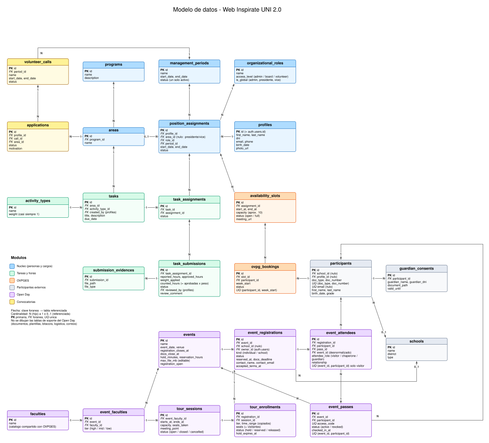

<style>
  /* 1. Fondo oscuro para las páginas del PDF */
  @page {
    background-color: #1e1e1e !important;
    margin: 20mm;
  }
  
  /* 2. Fondo oscuro y texto claro para todo el documento */
  html, body {
    background-color: #1e1e1e !important;
    color: #e0e0e0 !important;
    font-family: 'Courier New', Courier, monospace;
    font-size: 14pt;
    line-height: 1.6;
  }

  /* Respetar saltos de línea */
  p, li, div {
    white-space: pre-wrap;
  }

  /* 3. Títulos con contraste */
  h1, h2, h3, h4 {
    color: #4da6ff !important;
    margin-top: 20px;
    border-bottom: 1px solid #333333;
    padding-bottom: 5px;
  }

  /* 4. Listas y textos claros */
  li, p, strong, em {
    color: #e0e0e0 !important;
  }

  /* 5. Bloques de código */
  code {
    background-color: #2d2d2d !important;
    color: #ff79c6 !important;
    padding: 3px 6px;
    border-radius: 4px;
  }

  /* 6. Centrar imágenes y forzar fondo blanco SOLO en ellas */
  img {
    display: block !important;
    margin: 20px auto !important; /* Centra la imagen horizontalmente */
    max-width: 100% !important;
    background-color: #ffffff !important; /* Fondo blanco exclusivo de la imagen */
    padding: 15px !important; /* Margen interno para que las letras no toquen el borde */
    border-radius: 8px !important; /* Suaviza las esquinas del recuadro blanco */
  }

  /* Remover cualquier filtro de inversión previo */
  img[src$=".svg"] {
    filter: none !important;
  }
</style>

# Modelo de Datos - Web Inspírate UNI 2.0

Diseño lógico de la base de datos. En `backend/supabase/schemas/` está implementado el núcleo y tareas y horas (archivos `01` a `04`); el resto (participantes, OVPGES, Open Day y convocatorias) sigue como diseño. Complementa la sección 3 de [ARQUITECTURE.md](./ARQUITECTURE.md).

## 1. Diagrama entidad-relación



Fuente editable: `visuals/latex/modelo_datos/bd.tex`. Para regenerar el SVG (desde esa carpeta): `pdflatex bd.tex` y luego `dvisvgm --pdf bd.pdf -o bd.svg`.

El diagrama dibuja las tablas principales. Las tablas de soporte del Open Day (`registration_documents`, `document_templates`, `registration_events`, `registration_logistics`, `logistics_options`, `email_outbox`) se describen en las secciones 2 y 3, pero no se dibujan.

### Cardinalidades

Cada relación se lee de la tabla con la FK (N) hacia la tabla referenciada. `0..1` indica FK opcional (nula).

| Relación | Cardinalidad | Lectura |
|---|---|---|
| `areas` → `programs` | N : 1 | Un programa tiene varias áreas; cada área es de un programa |
| `position_assignments` → `profiles` | N : 1 | Una persona puede tener varias asignaciones (una por período) |
| `position_assignments` → `organizational_roles` | N : 1 | Un cargo se asigna a varias personas |
| `position_assignments` → `management_periods` | N : 1 | Un período agrupa muchas asignaciones |
| `position_assignments` → `areas` | N : 0..1 | Nula para presidente y vice (`is_global`) |
| `volunteer_calls` → `management_periods` | N : 1 | Un período puede tener varias convocatorias |
| `applications` → `volunteer_calls` | N : 1 | Una convocatoria recibe muchas postulaciones |
| `applications` → `areas` | N : 1 | Cada postulación es a un área |
| `applications` → `profiles` | N : 1 | Un postulante puede tener varias postulaciones |
| `tasks` → `areas` | N : 1 | Un área tiene muchas tareas |
| `tasks` → `activity_types` | N : 1 | Un tipo de actividad (con su peso) se usa en muchas tareas |
| `task_assignments` → `tasks` | N : 1 | Una tarea se asigna a varios voluntarios |
| `task_assignments` → `position_assignments` | N : 1 | Un voluntario recibe varias tareas |
| `task_submissions` → `task_assignments` | N : 1 | Una asignación puede tener varias entregas (p. ej. tras un rechazo) |
| `submission_evidences` → `task_submissions` | N : 1 | Una entrega tiene varias evidencias |
| `availability_slots` → `position_assignments` | N : 1 | Un voluntario publica varios bloques |
| `ovpg_bookings` → `availability_slots` | N : 1 | Un bloque admite hasta `capacity` reservas |
| `ovpg_bookings` → `participants` | N : 1 | Un participante reserva varias veces, pero una por semana |
| `participants` → `schools` | N : 0..1 | Los externos individuales pueden no tener colegio |
| `guardian_consents` → `participants` | N : 1 | Un menor puede tener varias autorizaciones (vencidas y vigente) |
| `event_registrations` → `events` | N : 1 | Un evento tiene varias inscripciones |
| `event_registrations` → `schools` | N : 0..1 | Nula en inscripciones individuales. Un colegio tiene una sola inscripción por evento |
| `event_faculties` → `events` | N : 1 | Un evento incluye varias facultades |
| `event_faculties` → `faculties` | N : 1 | Una facultad participa en varios eventos, con un nivel (`tier`) distinto en cada uno |
| `tour_sessions` → `event_faculties` | N : 1 | Una facultad repite su recorrido en varios horarios |
| `tour_enrollments` → `event_registrations` | N : 1 | Una inscripción reserva hasta 3 recorridos |
| `tour_enrollments` → `tour_sessions` | N : 1 | Una sesión recibe varias inscripciones hasta agotar `capacity` |
| `event_attendees` → `event_registrations` | N : 1 | Una inscripción lista visitantes, acompañantes y apoderados |
| `event_attendees` → `participants` | N : 1 | Un visitante está en una sola inscripción por evento; un adulto puede estar en varias |
| `event_attendees` → `event_passes` | N : 1 | Un pase (código) agrupa las filas de la misma persona en el evento |
| `event_passes` → `events` | N : 1 | Un evento emite un pase por persona |
| `event_passes` → `participants` | N : 1 | Una persona tiene un solo pase por evento |
| `registration_documents` → `event_registrations` | N : 1 | Una inscripción tiene varios documentos (versiones incluidas) |
| `registration_logistics` → `event_registrations` | N : 1 | Una inscripción pide varias opciones logísticas |
| `registration_logistics` → `logistics_options` | N : 1 | Una opción (bus, estacionamiento, etc.) la piden varias inscripciones |
| `registration_events` → `event_registrations` | N : 1 | Bitácora de cambios de estado y overrides de una inscripción |

## 2. Módulos

| Módulo | Tablas | Propósito |
|---|---|---|
| Núcleo | `profiles`, `programs`, `areas`, `management_periods`, `organizational_roles`, `position_assignments` | Personas, cargos por período y área |
| Tareas y horas | `activity_types`, `tasks`, `task_assignments`, `task_submissions`, `submission_evidences` | Asignar tareas, reportar horas con evidencia y revisión de directores |
| OVPGES | `availability_slots`, `ovpg_bookings` | Disponibilidad de voluntarios e inscripción grupal de escolares |
| Catálogo | `faculties` (y `careers`, ver plan) | Facultades y carreras; lo comparten OVPGES y Open Day |
| Open Day | `events`, `event_faculties`, `tour_sessions`, `event_registrations`, `tour_enrollments`, `event_attendees`, `event_passes` | Recorridos por facultad con cupos, inscripción individual y por colegio, y pase con código por persona |
| Open Day (soporte) | `registration_documents`, `document_templates`, `registration_events`, `logistics_options`, `registration_logistics`, `email_outbox` | Documentos en Drive, plantillas, bitácora, logística extensible y cola de correos |
| Participantes | `participants`, `schools`, `guardian_consents` | Escolares y externos (sin cuenta), con autorización de apoderado |
| Convocatorias | `volunteer_calls`, `applications` | Reclutamiento de voluntarios |

## 3. Decisiones tomadas

### 3.1 Sesiones OVPGES grupales
- Un `availability_slot` es un bloque con `capacity` (por defecto 10). Muchos escolares reservan el mismo bloque, cada uno con su fila en `ovpg_bookings`.
- El bloque pasa a `full` al llegar al cupo y se vuelve a `open` si alguien cancela. El portal público solo lista bloques `open`, a través de una vista segura que no expone al voluntario.
- La reserva pasa por una función RPC atómica (`book_ovpg()`), que bloquea el slot y valida el cupo.

### 3.2 Identidad con OTP y límite semanal
- El escolar se verifica con un OTP al correo **al momento de inscribirse** (no necesita cuenta permanente).
- `participants` se identifica por `(doc_type, doc_number)` único (`doc_type`: `dni`, `ce`, `passport`, `other`) y `email` único cuando existe, para que una persona no se duplique.
- Límite: `ovpg_bookings.week_start` (lunes de la semana del bloque, en `America/Lima`) con `UNIQUE (participant_id, week_start) WHERE status <> 'cancelled'`. Una persona no puede inscribirse a más de un bloque por semana, y no puede reservar todos los horarios.
- `book_ovpg()` también valida el límite y devuelve un error claro antes de intentar el insert.
- Interpretación: "una por semana" es por semana calendario (lunes a domingo). Si se quiere una ventana móvil de 7 días desde la última inscripción, la regla pasa de índice único a validación en la función.

### 3.3 Horas con peso
- `tasks.activity_type_id` apunta a `activity_types.weight` (casi siempre 1).
- Al aprobar, `task_submissions` guarda `weight_applied` (copia del peso en ese momento, para que cambiar el peso después no altere horas ya aprobadas).
- `counted_hours = approved_hours × weight_applied` (columna generada). Este valor es el que entra al reporte.
- La vista `extracurricular_hours` suma `counted_hours` de las entregas aprobadas por voluntario y período. Es una vista, no una tabla.

### 3.4 Quién crea tareas
- `organizational_roles` tiene `access_level` (`admin` / `board` / `volunteer`) y `is_global` (true para administrador, presidente y vice).
- `admin`: rol técnico, sin área. Además de lo de presidente y vice, gestiona períodos, roles, asignaciones y cuentas. Se asigna con un rol "Administrador" en `position_assignments`.
- Directores: solo crean y revisan tareas de su propia área.
- Administrador, presidente y vice (`is_global`): crean y revisan tareas de **todas** las áreas.
- Se aplica en las políticas RLS de `tasks`, `task_assignments` y `task_submissions`.

### 3.5 Menores de edad
- `participants.birth_date` es obligatorio.
- `guardian_consents(id, participant_id, guardian_name, guardian_dni, guardian_contact, document_path, accepted_at, valid_until)`: la autorización firmada de OVPGES se sube a Supabase Storage.
- `book_ovpg()` rechaza a un menor de 18 años sin una autorización vigente.
- **Open Day:** la autorización vigente es el documento de la inscripción, validado por el staff (ver 3.9), no una fila de `guardian_consents` por alumno. `guardian_consents` queda para OVPGES.
- La vigencia de una autorización es **por evento**.
- La mayoría de edad se calcula a la fecha del evento (`events.event_date`), no a la fecha de inscripción.

### 3.6 Open Day: inscripciones y asistentes
El Open Day dura **un solo día**. Cada facultad ofrece un recorrido de 1 a 2 horas que repite en varios horarios, y cada inscripción elige hasta 3 recorridos (ver 3.7). La inscripción se hace en dos formularios públicos (colegios y personas libres) sobre el mismo modelo.

- `event_registrations`: el trámite. `kind` es `school` o `individual`. Una inscripción **es una unidad**: no hay grupos. Un colegio tiene una sola inscripción por evento; si necesita más gente que el tope, el staff la ajusta con un override (3.8), pero la interfaz no lo ofrece.
- Una inscripción **individual** tiene exactamente 1 visitante, más adultos acompañantes opcionales (obligatorio al menos uno si el visitante es menor de edad).
- `event_attendees`: una fila por persona y por inscripción, con `attendee_role` y `relationship` (texto libre: "profesor", "madre", "chofer del bus"). Cada una se vincula a un `participants` con datos completos: nombres, documento de identidad (`doc_type` + `doc_number`), fecha de nacimiento, grado (visitantes) y, si se tiene, correo y teléfono.
- Los colegios cargan los datos de todos por formulario, pegando desde Excel o con CSV, validados con Zod en el cliente y de nuevo en el servidor, y se insertan en una sola transacción (RPC).
- Los alumnos de un colegio no pasan por OTP individual (el responsable se verifica con OTP). Por eso `participants.email` admite NULL, único cuando existe.

**Roles (`attendee_role`):**

| Rol | Etiqueta | Quién es | Ocupa cupo | Cuenta para la proporción | Edad |
|---|---|---|---|---|---|
| `visitor` | Visitante | Alumno de colegio o persona libre (menor o adulta) | **Sí** | No | Cualquiera |
| `chaperone` | Acompañante del colegio | Profesor, auxiliar o directivo que va con el colegio | No | **Sí**: mínimo `ceil(visitantes / students_per_chaperone)` (por defecto 10) | ≥ 18 |
| `guardian` | Apoderado | Padre, madre, tutor, cuidador u otro adulto que no es personal del colegio (incluye choferes e invitados) | No | No | ≥ 18 |

- El cupo de una sesión cuenta **solo** a los `visitor`.
- Los roles de adulto exigen ≥ 18 años a la fecha del evento (trigger).
- Un `chaperone` pertenece a una sola inscripción. Un `guardian` puede aparecer en varias (un padre con dos hijos que se inscriben por separado).
- Unicidad: `UNIQUE (event_id, participant_id) WHERE attendee_role = 'visitor'`. Para imponerlo, `event_attendees` guarda también `event_id` (copia de `event_registrations.event_id`, validada con un trigger).
- Si un documento de identidad ya figura como visitante en otra inscripción, el envío falla con un mensaje genérico que pide revisar los datos (sin revelar de quién es la otra inscripción). El conflicto queda en `registration_events` para el staff.

### 3.7 Recorridos, niveles y cupos
- `faculties` es el catálogo compartido con OVPGES. `event_faculties(event_id, faculty_id, tier)` incluye una facultad en un evento con su nivel de demanda: `high` (muy visitadas), `mid` (intermedias) o `low` (poco visitadas). El nivel está en el evento y no en la facultad porque cambia de un año a otro.
- `tour_sessions(event_faculty_id, starts_at, ends_at, capacity, seats_taken, meeting_point, status)`: cada repetición del recorrido. El staff las carga por CSV con la RPC `import_tour_sessions()`: idempotente (clave: facultad + inicio) y con una vista previa de los cambios antes de aplicar. Estados: `open`, `closed`, `cancelled`.
- `tour_enrollments(registration_id, session_id, tier, time_range, seats, status, hold_expires_at)`: lo que reservó una inscripción. `tier` y `time_range` se copian de la sesión (trigger) para poder imponer las reglas con restricciones. `seats` es la cantidad de visitantes. Estados: `held`, `reserved`, `released`.
- **Reservar** es la RPC `hold_tour()`: `UPDATE tour_sessions SET seats_taken = seats_taken + n WHERE id = $1 AND seats_taken + n <= capacity`; si no actualiza ninguna fila, no hay cupo. Atómico y sin bloqueos largos. `CHECK (seats_taken <= capacity)` es la última defensa. Los contadores se mantienen por triggers y una verificación periódica compara `seats_taken` con la suma real.
- **Retención vencida:** la RPC libera de forma perezosa las retenciones vencidas de la sesión antes de reservar, y un job de `pg_cron` (cada minuto) libera el resto.
- **Un recorrido por nivel:** `UNIQUE (registration_id, tier) WHERE status <> 'released'`. De ahí sale el máximo de 3.
- **Sin cruces:** `EXCLUDE USING gist (registration_id WITH =, time_range WITH &&) WHERE status <> 'released'`. `time_range` incluye un margen de traslado de `events.travel_buffer_minutes` (por defecto 15) porque la UNI es grande.
- **Regla de niveles:** la inscripción se inscribe en todos los niveles donde pueda y omite un nivel solo si ninguna sesión de ese nivel es viable. "Viable" significa: abierta, con cupo para todos los visitantes y sin cruce con lo ya elegido. Se valida en `confirm_selection()` como regla **maximal**: no puede quedar un nivel sin elegir que tenga una sesión viable. Mínimo 1 recorrido. La interfaz **avisa** (no bloquea) cuando una elección deja a otro nivel sin opciones. Si ninguna sesión de ningún nivel es viable, la inscripción no puede continuar y se muestra un mensaje de cupos agotados.
- **Si una sesión cambia:** `capacity` no puede bajar de `seats_taken`. Cancelar o mover una sesión marca las inscripciones afectadas como `needs_reassignment`, envía un correo y las deja elegir otra con prioridad. Se espera que las facultades no reduzcan cupos.
- **Disponibilidad pública:** vista segura `v_tour_availability` (sesiones, nivel y cupos restantes, sin datos de inscripciones), servida por un route handler de Next.js con caché corto (≈5 s) para que a la BD llegue una consulta cada pocos segundos sin importar cuántos usuarios haya. Realtime queda como mejora posterior. La verdad siempre la decide la RPC.

### 3.8 Estados, plazos y overrides
Estados de `event_registrations.status`:

| Estado | Significado |
|---|---|
| `draft` | Verificada por OTP; datos básicos en curso |
| `held` | Tiene al menos un recorrido en retención (30 min) |
| `reserved` | Selección confirmada y **bloqueada**; 48 h para completar datos y documentos |
| `submitted` | Enviada. Quedan bloqueados los recorridos y las personas; solo se pueden reemplazar documentos |
| `docs_observed` | El staff observó los documentos; se pueden reemplazar en un plazo que fija el staff |
| `confirmed` | Validada por el staff, con puerta y hora de llegada asignadas |
| `needs_reassignment` | Una de sus sesiones cambió o se canceló; debe elegir otra |
| `expired` / `cancelled` | Finales |

```
draft → held → reserved → submitted → confirmed
                  │          ↕
                  │     docs_observed
                  ↓
         expired / cancelled
```

- **Temporizador de elección:** uno solo por inscripción, de `hold_minutes` (30), con reloj del servidor, renovable una vez mientras conserve los cupos. Al vencer se liberan todas las retenciones.
- **Bloqueo:** `confirm_selection()` pasa a `reserved` y los recorridos ya no se cambian. La pantalla de confirmación lo advierte.
- **Plazo de documentos:** `docs_deadline = LEAST(reserved_at + reservation_hours, events.docs_close_at)`. `registration_closes_at` impide nuevas retenciones; `docs_close_at` es la última fecha para subir documentos (por defecto `registration_closes_at + reservation_hours`). Ambas se validan en el servidor.
- **Vencimiento automático:** solo antes de enviar (`draft`, `held`, `reserved`). Una inscripción `submitted` o posterior nunca se libera sola: solo la cancela el staff.
- **Overrides (solo `admin`):** reabrir, editar la lista de personas, superar topes o cupos y cancelar. Todos exigen un motivo y quedan en `registration_events` (quién, cuándo, de qué estado a cuál). Si cambia la lista, los pases de quienes salen pasan a `revoked`, se emiten los nuevos y se reenvía el PDF de códigos. La interfaz pública no menciona estas opciones; el colegio llama al staff por iniciativa propia.
- **Revisión (`board`):** valida o observa documentos, confirma y asigna puerta y hora de llegada, y exporta listas.
- **Anti-acaparamiento:** captcha en OTP y reserva, máximo de borradores activos por correo y tope de visitantes por inscripción. No hay lista de espera.

### 3.9 Documentos y Google Drive
- **Los PDFs van a Google Drive**, no a Supabase Storage, con el mismo patrón que las evidencias de horas: Edge Function con cuenta de servicio y `drive_file_id` en la BD. Esto reemplaza la decisión anterior de Storage para las autorizaciones de menores del Open Day.
- Como los archivos pueden ser grandes, la Edge Function **solo crea una sesión de subida reanudable** de Drive y el navegador sube directo a Google. Luego la función verifica por la API el tamaño, el tipo y que el archivo empiece con `%PDF`. Un job borra los archivos huérfanos.
- Tamaño máximo por archivo: `events.max_file_mb` (20 a 50 MB), editable sin redeploy. Se valida el tamaño declarado al crear la sesión y el real al terminar.
- El staff ve los archivos a través de una Edge Function que comprueba su rol; **no se comparten enlaces de Drive**.
- `registration_documents(registration_id, kind, drive_file_id, file_name, size_bytes, template_version, uploaded_at, verified_by, verified_at, superseded_at)`. `kind`: `school_consolidated`, `consent`, `guardian_declaration`, `commitment_letter`, `credentials`. Un archivo reemplazado queda con `superseded_at`; no se borra.
- `document_templates(kind, version, drive_file_id, active)`: plantillas oficiales descargables y **versionadas**, que se rellenan y se firman:
  - **Menores:** consentimiento + declaración jurada del apoderado + carta de compromiso.
  - **Adultos** (acompañantes, apoderados, visitantes mayores): consentimiento + carta de compromiso.
- **Colegios:** el responsable sube **un PDF consolidado** con todo; el staff lo valida con una lista de verificación. **Personas libres:** suben sus documentos (y los de su apoderado si es menor).
- La inscripción registra `accepted_terms_at` y `terms_version` (aviso de privacidad y declaración de responsabilidad del responsable).
- Una carta de compromiso (no dañar la infraestructura, etc.) es obligatoria para **todos** los asistentes.
- Todo acceso a archivos pasa por `lib/storage.ts`.

### 3.10 Pases y códigos
- `event_passes(event_id, participant_id, access_code, status, checked_in_at)`: un pase **por persona y por evento**, aunque el adulto aparezca en varias inscripciones. `UNIQUE (event_id, participant_id)` y `UNIQUE (access_code)`. Estados: `active`, `revoked`.
- `access_code`: 8 caracteres aleatorios en base32 Crockford, sin relación con el documento de identidad. Se genera al confirmar.
- `event_attendees.pass_id` referencia el pase. El código y el check-in viven en el pase, de modo que una persona se escanea una vez.
- El responsable recibe **todos los códigos juntos**: la página "Mis códigos" (imprimible) y un PDF adjunto al correo de confirmación. El PDF lo genera Apps Script (una tarjeta por persona con nombre, rol, código y QR; librería de QR dentro del script), guarda una copia en Drive (`registration_documents.kind = 'credentials'`) y lo envía. Se regenera si el staff cambia la lista.
- **Check-in:** una vista de la intranet que busca por código o documento y marca `checked_in_at` (muestra "ya ingresó a las X" si se repite). El día del evento el staff se apoya sobre todo en listas exportadas, sin app offline.

### 3.11 Configuración del evento
Todo vive en columnas de `events` y se edita desde el backoffice (solo `admin`), sin redeploy ni variables de entorno.

| Parámetro | Valor inicial | Uso |
|---|---|---|
| `event_date` | — | Fecha del evento (un solo día) y referencia de la mayoría de edad |
| `registration_opens_at`, `registration_closes_at` | cierre ≥ 7 días antes | Ventana para nuevas retenciones |
| `docs_close_at` | cierre + `reservation_hours` | Última fecha para subir documentos |
| `hold_minutes` | 30 | Temporizador de elección de recorridos |
| `reservation_hours` | 48 | Plazo para datos y documentos tras confirmar la selección |
| `max_file_mb` | 20 (hasta 50) | Tamaño máximo por archivo |
| `students_per_chaperone` | 10 | Proporción mínima de acompañantes |
| `max_visitors_per_registration`, `max_adults_per_registration` | por definir | Topes por inscripción de colegio |
| `travel_buffer_minutes` | 15 | Margen entre recorridos para evitar cruces |
| `registration_open` | `true` | Interruptor general para cerrar todo de inmediato |

### 3.12 Logística extensible
- `logistics_options(code, label, active)`: catálogo. Hoy `bus` y `parking`.
- `registration_logistics(registration_id, option_code, quantity, notes)`: lo que pidió cada inscripción (por ejemplo, 2 buses o 3 vehículos).
- Añadir una opción es un `INSERT` en el catálogo; el formulario la dibuja desde esa tabla, sin migración.

### 3.13 Identidad, correos y seguridad
- El responsable (colegio) o el visitante (libre) se verifica con **OTP de Supabase Auth**. `event_registrations.owner_id` guarda el `auth.users.id` y la RLS permite ver y editar solo lo propio.
- Para volver durante el plazo de 48 h entran a "Mi inscripción" (`/provov/open-day/mi-inscripcion`) con su correo y reciben un nuevo OTP. Cada inscripción tiene además un código de referencia corto (por ejemplo `OD-7K3F9`) para consultas con el staff. **No es una credencial.**
- El trigger `handle_new_user` crea una fila en `profiles` para cada usuario de `auth.users`, incluidos los visitantes con OTP. No es un problema de seguridad (los permisos salen de `position_assignments`), pero las pantallas de la intranet deben partir de `position_assignments` y no de `profiles`.
- **Sin escrituras directas:** los dueños no hacen `INSERT`/`UPDATE` sobre `event_registrations`, `event_attendees` ni `tour_enrollments`. Todo pasa por RPC `SECURITY DEFINER` con `search_path` fijo, que verifican `auth.uid()`.
- **Correos:** cola `email_outbox` (destinatario, plantilla, datos, estado, intentos). Un webhook dispara una Edge Function con reintentos e idempotencia. Correos: OTP, reserva con enlace y plazo, recordatorio antes de vencer, reserva vencida, inscripción recibida, documentos observados, confirmación con códigos, sesión cancelada y recordatorio previo al evento. La página "Mi inscripción" muestra siempre el estado completo, sin depender del correo.
- Proveedor de correo pendiente (ver 5). Hace falta SMTP propio para el OTP, porque el integrado de Supabase tiene un límite muy bajo.
- **Datos de menores:** aviso de privacidad y consentimiento de tratamiento en el formulario (Ley 29733), acceso solo para el staff autorizado y carpetas de Drive privadas. Por ahora no se borran los datos; el esquema debe permitir anonimizar o borrar después.

## 4. Reglas generales a imponer en la BD

- **Autenticación:** `profiles.id` referencia `auth.users.id`; no se guarda contraseña.
- **Autorización:** RLS según la asignación activa (`access_level`, `is_global`, `area_id`).
- **Un período activo:** índice único parcial sobre `management_periods` con `state = 'active'`.
- **Estados** como enums de Postgres, no texto libre.
- **Flujo de entrega:** `assigned → submitted → approved | rejected` (con `reviewed_by` y `reviewed_at`).
- **Sin solapes:** `EXCLUDE USING gist` sobre el rango de cada voluntario en `availability_slots` y sobre los recorridos de cada inscripción en `tour_enrollments`. Requiere la extensión `btree_gist`, que aún no está en `schemas/00_extension.sql`.
- **Una inscripción de colegio por evento:** índice único parcial sobre `(event_id, school_id)` donde `school_id` no es nulo y el estado no es `expired` ni `cancelled`.
- **Cupos:** `seats_taken` se actualiza solo desde las RPC y por triggers; `CHECK (seats_taken <= capacity)`.
- **Zona horaria:** todas las fechas son `timestamptz`; la presentación y el cálculo de semanas usan `America/Lima`.
- **Extensiones para el Open Day:** `btree_gist`, `pg_cron` (liberar retenciones y enviar recordatorios) y `pg_net` o webhooks de base de datos (cola de correos).

## 5. Pendiente de definir

1. ¿Hay tareas abiertas que los voluntarios puedan tomar, o las asigna siempre un director?
2. ¿Se permite reportar horas sin tarea previa?
3. Semana calendario o ventana móvil de 7 días para el límite de OVPGES (ver 3.2).
4. Open Day: tope de visitantes y de adultos por inscripción de colegio, y de adultos por inscripción libre.
5. Open Day: proveedor de correo gratuito (Brevo, Resend o solo Apps Script). Depende de si hay dominio propio.
6. Open Day: ¿la UNI limita el aforo total del campus por día o franja? Si sí, hace falta otro tope.
7. Open Day: fecha del evento, fechas de cierre y facultades con su nivel.
8. Open Day: redacción y revisión legal de las plantillas (consentimiento, declaración jurada, carta de compromiso) y del aviso de privacidad.
9. Open Day: política de retención de datos de menores (hoy no se borran).
10. Open Day: prueba de subida a Drive con la cuenta real (la cuenta de servicio puede no tener cuota propia) y de CPU de Apps Script al generar el PDF de códigos.

### Resueltas

- Vigencia de la autorización de un menor: **por evento** (ver 3.5).
- Alumnos sin DNI: se admite otro documento con `doc_type` (`dni`, `ce`, `passport`, `other`).
